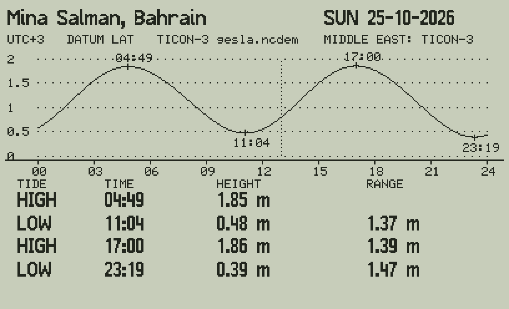

# Tide 47 🌊

Tide predictions for the **C47 / R47** RPN calculator (and the DM42n with the C47 firmware): the high and low waters
and the tide curve of any day, for 25 ports, computed on the calculator by the harmonic method of NOAA and the
Admiralty.

The program sums 45 harmonic constituents (NOAA's standard 37 and 8 more from TICON) with the 18.6-year nodal
corrections f and u of Schureman's *Manual of Harmonic Analysis and Prediction of Tides* - the method behind NOAA's and
the Admiralty's tables. The work is done with whole matrices, so the firmware does it element by element:

| | |
|---|---|
| the phases | `P = DM × AV + UM × BV − G` (MOD 360): DM the Doodson numbers (45 × 7), AV the astronomical angles τ s h p N′ p′ of the day, UM and BV the nodal phases u |
| the amplitudes | `A = eˣ(EM × LF + LH)`: EM the node-factor powers (45 × 10), LF the logs of the 10 basic factors, LH the logs of the port's amplitudes: f × H without a loop |
| a height | `Z0 + A · COS(W t + P)`: one COS of a 45-vector and one DOT |
| high and low waters | the sign of h′ every hour (`AW · SIN(W t + P)`), then four Newton steps (`AW2 · COS`) |

| | |
|---|---|
| Files | `build/TIDE47.txt` (the program) and the data programs `build/TIDEME.txt`, `TIDEUS.txt`, `TIDELA.txt` (convert each with rejig; load all four); commented source `programs_rem/TIDE47.txt` |
| Needs | C47 / R47 firmware with STRUCT, ATEXT, GRFNT (00.109.05.00a0.ALPHA, 5 Oct 2026, or later) |
| Size | TIDE47 2 006 steps (about 8 KB); TIDEME 1 245, TIDEUS 1 553, TIDELA 1 091 steps (about 5-6 KB each) |
| Speed | the start about 7 s, a new day or port about 3.5 s (the simulator's step count) |
| At the end (0) | your stack and LASTx as before; R00-R19 untouched, R20-R99 cleared; the matrices deleted; GRMOD 0, GRFNT 20; the angle mode DEG |

## Using it

`XEQ "TIDE47"`: today at Mina Salman. The day is the calculator's date; the dotted line is its clock (set the
calculator to the port's local time).

| Key | |
|---|---|
| **4 6** | the day before / after |
| **1 3** | the week before / after |
| **5** | today |
| **8 2** | the port before / after |
| **+** | the next region: MIDDLE EAST, USA, LATIN AMERICA |
| **0** | the end |

The screen follows Almanac 47's split view: the port and the date, the time zone, the datum and the source; the day's
curve (hours 00-24, heights in metres above the datum) with each high and low water marked; the table of the high and
low waters with their heights and ranges.

## The ports

| Region | Ports | Data | Datum |
|---|---|---|---|
| MIDDLE EAST | Mina Salman (Bahrain), Mina Qaboos (Muscat), Masirah, Salalah, Chabahar, Karachi, Aden, Djibouti | TICON-3 (GESLA-3 gauges, CC-BY 4.0) | LAT |
| USA | Boston, New York (Battery), Charleston, Key West, Galveston, San Diego, San Francisco, Seattle, Honolulu, San Juan | NOAA CO-OPS (public domain) | MLLW |
| LATIN AMERICA | Cartagena, Santa Marta, Cristóbal, Balboa, Buenaventura, Tumaco, La Libertad | TICON-3 | LAT |

LAT, the Admiralty chart datum (the lowest astronomical tide), is computed for the TICON ports from their constants
over 19 years (2020-2038). The US ports keep NOAA's datum, MLLW, so their heights are NOAA's. Times are the ports'
standard time; the US ports follow US daylight time (the whole day, from the second Sunday of March to the first
Sunday of November). `python3 tools/make_stations.py` writes the ports (`python/stations.py`); more ports can be added
from TICON-3's 3 363 gauges.

## Accuracy

- The astronomy (V0 + u and f) agrees with NOAA's tables (as XTide has them) within 0.07 degrees and 0.0003 for the
  main constituents over 2020-2040 (M1, the smallest: 0.4 degrees).
- A year of predictions analysed by an independent program (UTide) gives back the port's constants within 5 mm and
  0.3 degrees.
- The C47 program and the Python twin (`python/tide47ref.py`) give the same high and low waters, to 0.01 s and
  1E-12 m, for every port on several days.

With good constants the harmonic method is what the official tables use; the differences that remain come from the
constants (TICON's are from 5-20 years of a gauge, the official ones from longer records and more constituents). **Not
for navigation**: the predictions are the astronomical tide only (wind, pressure and surges add to it), and the
official tables of the port authority are the reference.

## Tested

In the C47 simulator (`python/c47sim.py`, from Almanac 47) with `python3 tests/test_tide47.py`: the astronomy against
NOAA, the twin against UTide, the C47 against the twin (25 ports × 3 days, the US daylight-time changes), the keys, the
end (registers, matrices, the stack).

**Not yet run on a real C47.** The matrix commands are those of Almanac 47 (M × M, M + M, COS / SIN / eˣ of a matrix,
DOT, M × r, MOD); new here: **LN** (of a number and of a matrix, element by element) and IP / MOD of a matrix. Please try
`2 LN` and the program.

## Files

| | |
|---|---|
| `programs_rem/TIDE47.txt` | the commented source (STRUCT, named labels) |
| `tools/build_tide47.py` | writes `programs/`, `build/` and `listings/`: TIDE47 and the data programs |
| `tools/make_stations.py` | writes `python/stations.py` from XTide's NOAA data and TICON-3 (LAT computed) |
| `python/tide47ref.py` | the engine in Python, step for step as the program (`python3 python/tide47ref.py Bahrain 2026-10-25`) |
| `python/tide47sim.py` | runs the programs in the simulator and writes the screens in `docs/` |
| `python/c47sim.py`, `stdfont.py`, `tinyfont.py` | the C47 simulator and fonts, from Almanac 47 |
| `tests/test_tide47.py`, `tests/xtide_tables.json` | the tests above |

## Author

By Victor Valdes (valdes.vj@gmail.com), Master Mariner.

Thank you to the C43/C47 firmware developers and SwissMicros, to NOAA CO-OPS, to the TICON authors (DGFI-TUM) and to
David Flater (XTide). Written with the help of AI. See `AI_ASSISTANCE.md` for the responsible-use statement.

## License

Published under the [GNU General Public License v3.0](LICENSE); the data's terms are in `NOTICE` (NOAA public
domain, TICON-3 CC-BY 4.0).
