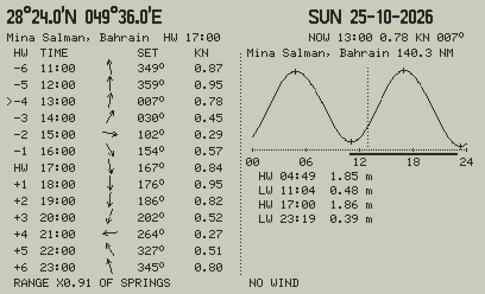

# ARTF47: Aramco tide and flow at a position

`XEQ "ARTF47"` puts FLOW47 and TIDE47 on one screen, for the Aramco region only:



*(The picture uses a synthetic atlas and the Middle East ports in place of Aramco's; the real data are private.)*

| | |
|---|---|
| the inputs | `LAT` `LON` (DD.MMm) and the wind `WDIR` `WKN`, as FLOW47 |
| left: the stream | FLOW47's table at the position: HW−6 … HW+6 of Ras Tanura's High Water (the atlas's reference), the clock time, an arrow, the set and the knots, springs scaled to the day's range, the wind added; `>` the hour now |
| right: the tide | the Aramco station **nearest the position** (its name and distance in nm): the day's curve, the 13 hours of the table marked as a bar under the time axis, now as a dotted line, and the high and low waters (time, height) |
| the keys | **4 6** the High Water before / after, **1 3** the day before / after, **5** now, **7** a new position or wind, **0** the end |

Outside the atlas (or on land) the left side says so and the tide is still shown: the nearest station works for any
position (the Red Sea stations too).

## The build

```bash
python3 tools/make_private.py --rayleigh 0.9      # the Aramco constants (python/stations_private.py)
python3 tools/build_tide47.py --artf              # -> private/build_artf/: TIDE47 (with FLOW47 and ARTF47), TIDEAR, TIDEFL
```

Convert the three files of `private/build_artf/` with rejig and load them (this TIDE47 replaces the others). Its
TIDE47 has the Aramco region only. `python/flow_private.py` (the atlas) is needed as for FLOW47 (docs/FLOW.md).

## How it computes

The stream: as FLOW47 (docs/FLOW.md). The tide: the nearest station by the hypotenuse of the latitude difference
and the longitude difference × cos latitude (× 60: nm), its day computed by TIDE47's engine. A key that changes the
High Water loads Ras Tanura again (the atlas's reference), then the nearest station: two days computed when the
nearest is not Ras Tanura. `tide47ref.art_nearest`, `day` and `flow_*` are the twin; tests (8) check the C47
against them.
