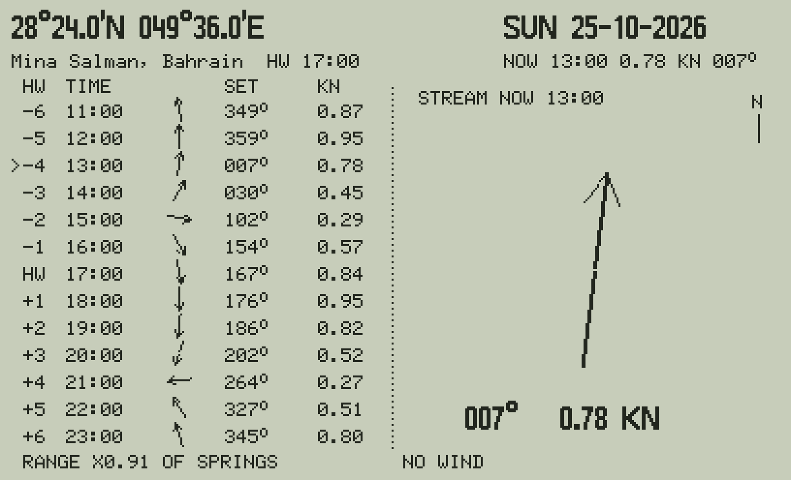

# FLOW47: the tidal stream atlas at any position

`XEQ "FLOW47"` asks for the position and the wind, then shows the 13 hours of a tidal-stream atlas (charts
**HW−6 … HW+6** at a reference station) for that position, on the High Water nearest now:



*(The picture uses a synthetic atlas and Mina Salman as the reference station; the real atlas is private.)* FLOW47
is in the TIDE47 of `private/build_flow/` only (`build_tide47.py --flow`).

| | |
|---|---|
| the inputs | `LAT` `LON` in DD.MMm (− south / west; the same variables as Almanac 47, so they are remembered), `WDIR` the wind's direction (from, degrees) and `WKN` its speed (knots; 0: no wind) |
| the header | the position and the day; the reference station and its High Water; **NOW** the stream at the calculator's clock (when now is within the cycle) |
| the table | HW−6 … HW+6: the clock time, an arrow, the set (where the stream goes, degrees true) and the knots; `>` marks the hour nearest now; below, the day's range as a fraction of the mean spring range |
| the arrow | one big arrow: the stream now (or at High Water when now is outside the cycle), its set and knots below it |
| the keys | **4 6** the High Water before / after, **1 3** the day before / after, **5** now, **7** a new position or wind, **0** the end |

## How it computes

1. **The reference station's High Water**: Tide 47's own engine (the private Aramco constants of Ras Tanura) gives the
   day's high and low waters; FLOW47 takes the High Water nearest now (the next or previous day's when now is more
   than 6.2 hours from all of that day's).
2. **The atlas at the position**: the charts were digitized onto a grid every 10′ (19 × 13 nodes, 192 at sea);
   the position's 13 streams are the bilinear mean of the four nodes around it (land nodes left out). Outside the
   charts or on land: *no atlas here*.
3. **Springs and neaps**: the charts are spring tides; each stream is scaled by that High Water's range (its height
   − the mean of the low waters next to it) / the mean spring range 2 (H M2 + H S2) at the reference station.
4. **The wind**: a surface current of 2.5 % of the wind speed, towards downwind turned 15° to the right, added to
   every hour (a rule of thumb; your DP log can calibrate it).

`python/tide47ref.py` `flow_*` is the twin; `tests/test_tide47.py` (6) checks the C47 against it with a synthetic
atlas: the same High Waters through the keys and the same values (2E-9).

## Making the private build

The atlas (a copy of a Saudi document, *Arabian Gulf Tidal Flow*) may not be published, so it is digitized on your
computer and kept out of git (`private/` and `python/flow_private.py` are in `.gitignore`):

```bash
pip install opencv-python numpy scipy            # and poppler's pdftoppm
python3 tools/digitize_atlas.py tidal_flow.pdf --first-page 2   # the 13 charts -> private/atlas/arrows.json
python3 tools/make_flow.py                        # -> python/flow_private.py (the grid; reference: Ras Tanura)
python3 tools/make_private.py --rayleigh 0.9      # the Aramco constants (Ras Tanura is the reference)
python3 tools/build_tide47.py --flow              # -> private/build_flow/: TIDE47 with FLOW47, TIDEFL, the data
```

FLOW47 is built apart, in its own folder: `private/build_flow/` holds a TIDE47 with FLOW47 in it (the other builds,
`build/` and `private/build/`, have no FLOW47), TIDEFL (the atlas) and the data programs. Convert them with rejig and
load that TIDE47 (instead of the other), TIDEFL, TIDEAR (Ras Tanura is in it) and the other data programs you want;
FLOW47 says so when TIDEAR is not loaded. The reference station is found by name in the private regions;
`--flow-ref "name"` chooses another (`make_flow.py --ref` sets the default).

**The digitizer**: each chart's graticule is fitted from its tick marks (Mercator, 3-4 pixels rms, about 0.4 nm),
upside-down pages are turned, each arrow's direction is read from its shape (the head is the wider end) and checked
against its neighbours (a head read at the wrong end is turned), its speed from the background colour band (the
bands' middles: 0.13 0.38 0.63 0.88 1.25 kn). About 500 arrows a chart.

## Which reference port? (tools/flow_refcheck.py)

The charts say "High Water" but not where. Two things say Ras Tanura rather than Dammam:

- **The charts themselves**: in the Dammam - Bahrain channel the stream runs south, into the Gulf of Bahrain, from
  HW−3 to HW+3 of the reference (strongest at HW) and turns north at about **HW+2.9**. A basin floods until its own
  High Water, so the reference's High Water must come about 3 hours before the Gulf of Bahrain's (Mina Salman's).
  Dammam's tide is close to Bahrain's in time, so Dammam as the reference would put the strongest flood at the
  basin's High Water: the wrong way round.
- `python3 tools/flow_refcheck.py` (on your computer, with the Aramco constants) prints each Gulf station's High Water
  against Ras Tanura's and its lead on Mina Salman: the reference should lead by about 2.9 h.

It matters: an hour's error in the reference changes the predicted streams at the fields by about 0.17 kn rms
(2 h: 0.25, 3 h: 0.32), as much as the streams themselves (0.1-0.35 kn). The real test is your own observations: put
the DP log's currents in `private/obs/currents.txt` (date, time, lat, lon, set, knots) and the tool scores each
candidate reference and the best extra time offset.

## How far to trust it

- **The speeds are bands**: the charts give five colour bands, so a speed is good to about ±0.12 kn; directions
  to about ±10°.
- **The reference station is a guess**: the charts say "High Water" but not where; Ras Tanura is assumed (Aramco's
  main station, between the fields and Dammam). An hour's error shifts the whole pattern by an hour: near slack
  water, treat the times as ±1 hour until a few observed slacks confirm it.
- **One cycle**: the charts show one cycle with a strong daily inequality (HW−6 and HW+6 differ); other days'
  cycles differ, and the range scaling only corrects the size.
- **Tide only**: the shamal and the Gulf's density-driven circulation add currents of their own; the wind rule is
  a rough estimate. Your DP's measured current is the reference.

Not for navigation.
