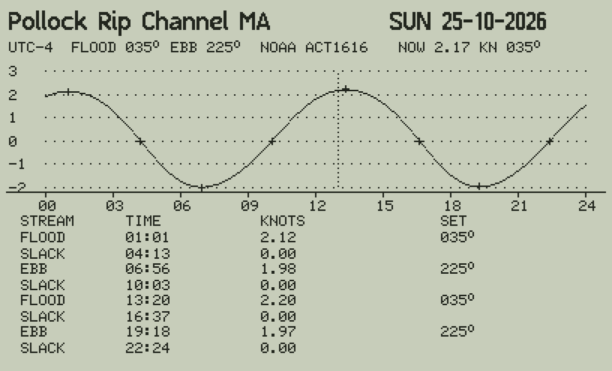

# Tidal streams

Tide 47 v0.2 predicts tidal streams (tidal currents) on the C47 with the same engine as the tides: the same 60
constituents, the same astronomy and nodal corrections, the same matrices. A stream station is one of two kinds:

| kind | constants | the curve | the events |
|---|---|---|---|
| **rectilinear** (most current tables: NOAA, and tables that give slack and the maximum flood and ebb) | the speed along the flood direction, knots (+ flood, − ebb), and the flood and ebb sets | the signed speed: flood above 0, ebb below | **SLACK** (the speed through 0), **FLOOD** and **EBB** (the maxima) with their speed and set |
| **rotary** (open water, where the stream turns through the compass) | the east component u and the north component v, knots | the speed | **MAX** and **MIN** of the speed, with the speed and the set |

The events are the turning points of the speed: `g = u u′ + v v′` (half the derivative of the speed squared) changes
sign within the hour, then four Newton steps with `g′ = u′² + v′² + u u″ + v v″` — one routine for both kinds (on a
rectilinear station a slack is a minimum where the speed is 0). The set is the direction the stream goes, degrees true.
When the day is today, the header shows the stream **NOW** at the calculator's clock (useful on DP: set the clock to
the field's local time).



## The public stations: US STREAMS (NOAA)

Seven NOAA current stations (public domain, from XTide's harmonics file): Pollock Rip Channel MA, Charleston Harbor
SC, Tampa Bay entrance FL, Bolivar Roads TX, San Diego Bay entrance CA, Admiralty Inlet WA, Deception Pass WA. They
show the method and test it; `tools/make_streams.py` writes them (`python/streams.py`). NOAA's ebb set is not always
opposite the flood (Admiralty Inlet: 180° and 347°): each kept as NOAA gives it.

## The Gulf fields: your GEOSA tables (private)

TICON-3 and NOAA have no stream stations in the Arabian Gulf. The Saudi tidal current tables are published by the
General Commission for Survey and Geospatial Information (GEOSA, *Saudi Tidal Currents Tables*, a book or PDF, a new
edition each year, 150 SR from info@geosa.gov.sa); the electronic copy is not to be published. So, as with Aramco's
tide tables, Tide 47 works out the constants **on your computer** from the tables, and they never go to GitHub
(`private/` and `python/streams_private.py` are in `.gitignore`).

1. A file a station in `private/streams/` (start from `docs/stream_templates/geosa_station.txt`):

   ```bash
   mkdir -p private/streams && cp docs/stream_templates/geosa_station.txt private/streams/safaniya.txt
   ```

   Fill the header (the name on the C47, the position, the time zone, the kind, and for a rectilinear station the
   flood and ebb sets from the station's page), then the rows in the tables' local time, knots, degrees true:

   ```
   SLACK 2027-01-01 03:40              slack water
   FLOOD 2027-01-01 06:55 1.8          the maximum flood (its set: the header's flood)
   EBB 2027-01-01 13:10 1.6            the maximum ebb
   MAX 2027-01-01 06:55 1.8 132        a maximum with its speed and set (either kind)
   MIN 2027-01-01 03:40 0.2 41         a minimum with its speed and set (rotary)
   2027-01-01 04:00 1.2 135            a speed and set at a time (hourly tables)
   CONST M2 0.95 120.0 [0.62 300.0]    constants, if the tables print them (rotary: u then v)
   Z0 0.05 [-0.02]                     their means
   ```

   If the PDF has the predictions as text (as Aramco's tide tables had), they can be read out of it in seconds rather
   than typed: attach the PDF in a session and say which stations.

2. The constants (least squares with Tide 47's own astronomy; a flood / ebb or MAX gives its speed and `s′ = 0` at its
   time, a slack `s = 0`; rotary MAX / MIN give `u u′ + v v′ = 0`):

   ```bash
   python3 tools/make_private_streams.py --test-from 2027-10-01    # fit before Oct 1, compare from Oct 1
   python3 tools/make_private_streams.py                           # then fit the whole year
   ```

   `--test-from` writes `private/STREAMS_COMPARE.md`: per station the events compared and the differences in time
   (minutes) and speed (knots), on rows the fit did not see — the honest measure of how well the constants predict.

3. The calculator files:

   ```bash
   python3 tools/build_tide47.py --private
   ```

   writes `private/build/TIDE47.txt` (with a region GULF STREAMS, and ARAMCO if its tide constants are there) and
   `private/build/TIDEGS.txt`. Convert both with rejig; load them with TIDEME, TIDEUS, TIDELA, TIDECU from `build/`.

## How accurate

On current tables made from known constants (`tests/synth_streams.py`), a year fitted and the next year predicted:

| tables | the next year |
|---|---|
| rectilinear: SLACK, FLOOD, EBB (times to the minute, speeds to 0.1 kn) | times 0.3 min rms (worst 1 min), speeds 0.03 kn rms |
| rotary: MAX, MIN with speed and set | times 1.0 min rms (worst 8 min: a flat minimum), speeds 0.03 kn rms |
| rotary: hourly speed and set | speeds 0.03 kn rms, sets within 1° |

The 0.03 kn is the tables' own rounding. With GEOSA's tables Tide 47 should reproduce them about as closely; it cannot
be more accurate than they are. The C47 program and the twin (`tide47ref.sday`) give the same events to 0.01 s and
1E-9 kn (tests 5).

**Not for navigation or DP decisions on its own.** These are tidal streams only: in the Gulf the wind (the shamal) and
the density-driven circulation add currents of their own, often as strong as the tide on the open fields, and the
streams at a platform differ from a station's some miles away. Your DP system's measured current and the official
tables are the reference.
