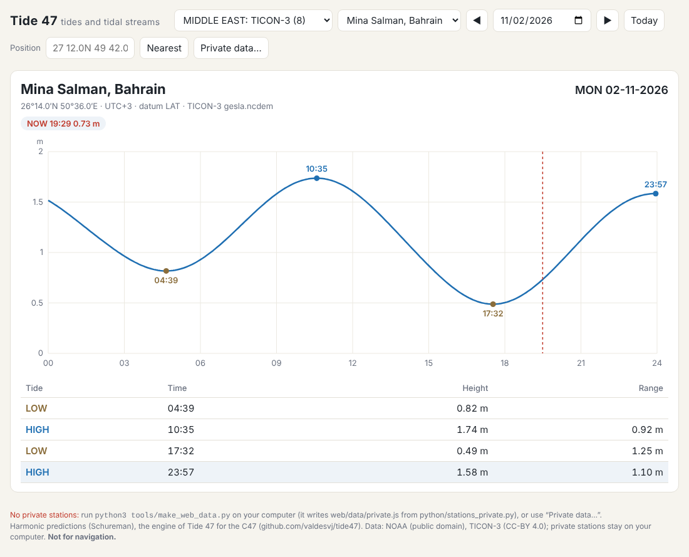

# Tide 47 on the web

The Tide 47 engine in JavaScript (`tide47.js`, the method of `python/tide47ref.py`, exact) with a one-page app: a
region, a station, a day: the curve, the high and low waters (a stream: slacks, maxima, sets), now, and the station
nearest a position.



## Run it

```bash
cd ~/opt/tide47
python3 tools/make_web_data.py            # data/cons.js, data/public.js, and data/private.js from your Aramco stations
google-chrome web/index.html              # or: chromium web/index.html  (it works as a file, no server needed)
```

Or serve it (for a phone on the same network): `python3 -m http.server 8047 -d web`, then
`http://localhost:8047` (or `http://<your computer's address>:8047` on the phone).

| | |
|---|---|
| region, station | the private regions first (★, from `data/private.js`), then the public ones |
| ◀ ▶, the date, Today | the day; keys ← → (day), ↑ ↓ (station), T (today) |
| Position + Nearest | `27 12.0N 49 42.0E` or `27.2 49.7`: the nearest tide station |
| Private data… | load a `private.js` from another computer (a phone has no `data/private.js`) |

## Private data

`tools/make_web_data.py` writes `web/data/private.js` from `python/stations_private.py` (and
`python/streams_private.py`): your Aramco stations. It is in `.gitignore`: it never goes to git, never to a public site.
The public stations (NOAA public domain, TICON-3 CC-BY 4.0) are in `data/public.js`.

## Checked

`python3 tests/test_web.py` (node): the constituents' V + u and f against the twin to 1E-13 degree; 640 station-days
(every public tide and stream station, 20 days) against the twin's exact events: the same events, times within 0.01 s.

Not for navigation.
